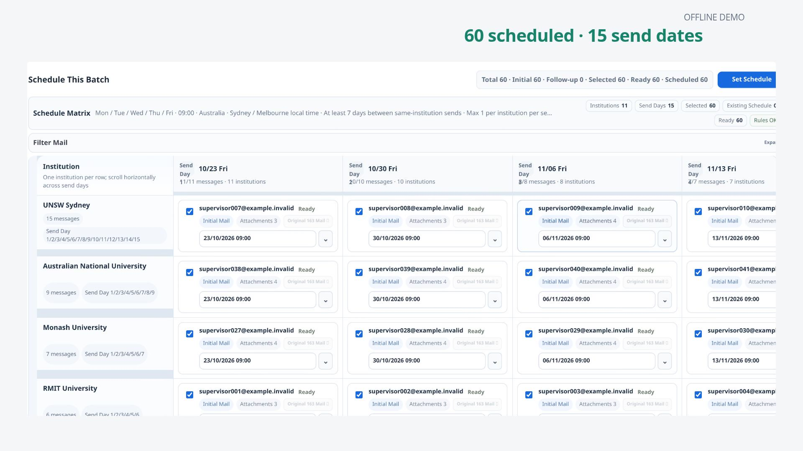
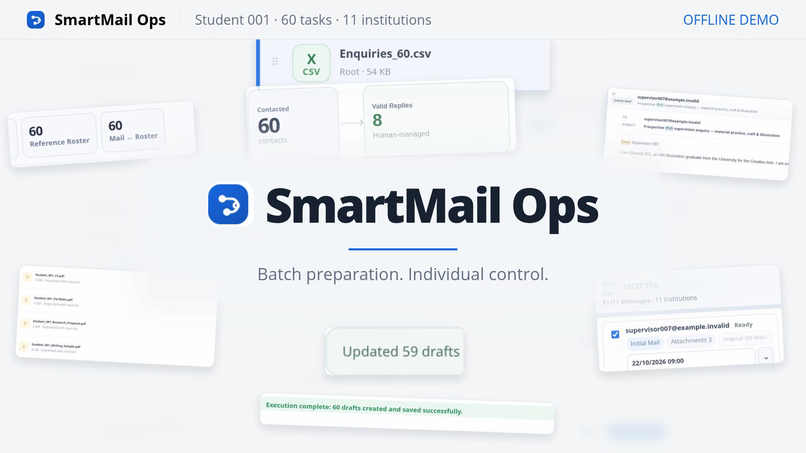
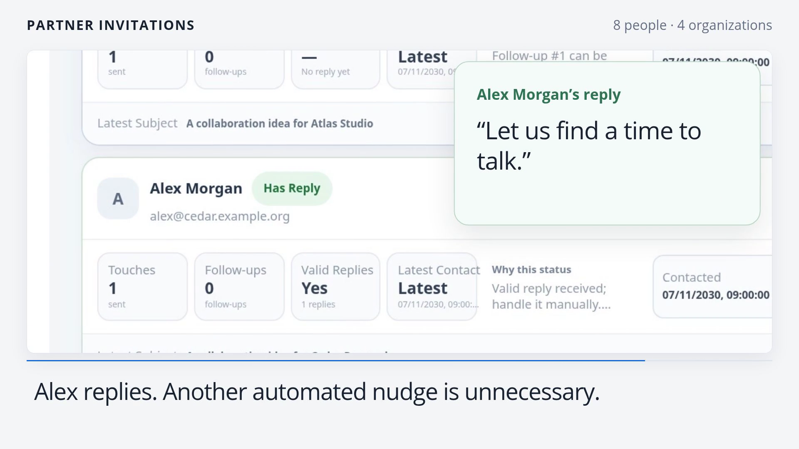
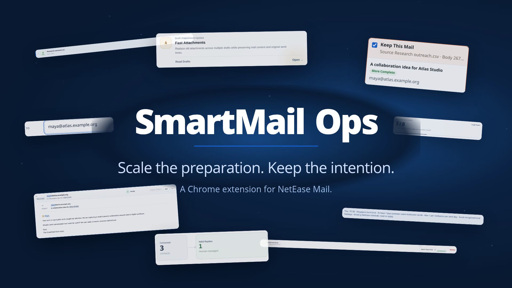

# SmartMail Ops

A Chrome extension for preparing, reviewing, scheduling and maintaining personalized outreach drafts in NetEase Mail. The extension's entry point is `manifest.json`; the application opens from `app.html`.

## Product film — Show the decisions

A rebuilt 108-second English film, 1920×1080 at 30 fps. The 60-contact campaign now exposes how content becomes mail or roster input, how normalized email keys and probable contacts are checked, how attachment paths resolve, and why each candidate date is accepted or rejected. The actual full-batch preview scrolls from first to last record. Explanation follows the active fields, keys, files and dates; there is no fixed subtitle strip.

- [Video with music and sound effects](https://github.com/Saul2023goodman/VideoClipMail/raw/refs/heads/main/films/smartmail-process-film/out/smartmail-process-with-music.mp4?download=1)
- [Video with sound effects only](https://github.com/Saul2023goodman/VideoClipMail/raw/refs/heads/main/films/smartmail-process-film/out/smartmail-process-sfx-only.mp4?download=1)
- [Editable project ZIP](https://github.com/Saul2023goodman/VideoClipMail/raw/refs/heads/main/films/smartmail-process-film/out/SmartMail-Process-Editable-Project.zip?download=1)
- [Optional English SRT](films/smartmail-process-film/out/smartmail-process-english.srt)

The [project](films/smartmail-process-film/README.md) includes the new DOCX/XLSX/PDF fixtures, native recordings, exact motion-reference sources, an editable 66-clip workbench timeline and verification evidence. The unchanged extension processes fictional recipients through an offline provider. Input bodies are prepared documents; the ending records 60 verified draft saves. See the [independent review](films/smartmail-process-film/analysis/independent-review.md) for the verified scope.

## Previous film — Sixty enquiries, one controlled workflow

A complete 108-second English remake, 1920×1080 at 30 fps, using Student 001's 60-contact campaign and the supplied House Vibez track. The batch moves through source classification, task normalization, roster matching, individual review, 211 attachment links, 15 institution-aware weekly send dates, sequential draft execution, 59 verified proposal replacements and reply-aware follow-up selection.

- [Video with music and sound effects](https://github.com/Saul2023goodman/VideoClipMail/raw/refs/heads/main/films/smartmail-batch-film/out/smartmail-batch-with-music.mp4?download=1)
- [Video with sound effects only](https://github.com/Saul2023goodman/VideoClipMail/raw/refs/heads/main/films/smartmail-batch-film/out/smartmail-batch-sfx-only.mp4?download=1)
- [Editable project ZIP](https://github.com/Saul2023goodman/VideoClipMail/raw/refs/heads/main/films/smartmail-batch-film/out/SmartMail-Batch-Editable-Project.zip?download=1)
- [English captions](films/smartmail-batch-film/out/smartmail-batch-english.srt)

The [project](films/smartmail-batch-film/README.md) includes new native footage, motion source, an 82-clip workbench manifest and verification evidence. The unchanged extension runs with anonymized inputs and explicitly labelled offline provider responses. See the [independent review](films/smartmail-batch-film/analysis/independent-review.md) for verified scope.

## Previous film — One campaign, from import to reply

An 84-second English film, 1920×1080 at 30 fps. One campaign follows eight people at four organizations: remove a duplicate draft, correct a copied greeting, match the shared brief, separate colleagues' send dates, replace an outdated attachment, and handle a human reply. A continuous camera follows the native operations and their visible results.

### Direct downloads

- [Video with music and sound effects](https://github.com/Saul2023goodman/VideoClipMail/raw/refs/heads/main/films/smartmail-scenario-film/out/smartmail-ops-with-music.mp4?download=1)
- [Video with sound effects only](https://github.com/Saul2023goodman/VideoClipMail/raw/refs/heads/main/films/smartmail-scenario-film/out/smartmail-ops-sfx-only.mp4?download=1)
- [Editable project ZIP](https://github.com/Saul2023goodman/VideoClipMail/raw/refs/heads/main/films/smartmail-scenario-film/out/SmartMail-Ops-Editable-Project.zip?download=1)
- [English subtitles](films/smartmail-scenario-film/out/smartmail-ops-english.srt)

The [editable project](films/smartmail-scenario-film/README.md) includes native media, a Remotion composition, 57 workbench clips, licenses and review evidence. The scenario uses fictional offline contacts and mailbox data. See the [independent review](films/smartmail-scenario-film/analysis/independent-review.md) for the verified scope and limitations.

## Previous film — Chaos, choreographed

A 54-second English product film, 1920×1080 at 30 fps, covering the workflow across eleven scenes: source classification, roster matching, duplicate decisions, continuous review, native highlights and editing, attachment rules, institution scheduling, draft maintenance, reply handling and performance.

### Direct downloads

- [Video with music and sound effects](https://github.com/Saul2023goodman/VideoClipMail/raw/refs/heads/main/films/smartmail-chaos-choreographed/out/smartmail-ops-with-music.mp4)
- [Video with sound effects only](https://github.com/Saul2023goodman/VideoClipMail/raw/refs/heads/main/films/smartmail-chaos-choreographed/out/smartmail-ops-sfx-only.mp4)
- [Editable project ZIP](https://github.com/Saul2023goodman/VideoClipMail/raw/refs/heads/main/films/smartmail-chaos-choreographed/out/SmartMail-Ops-Editable-Project.zip)
- [English subtitles](films/smartmail-chaos-choreographed/out/smartmail-ops-english.srt)

The editable source and local media are in [films/smartmail-chaos-choreographed](films/smartmail-chaos-choreographed/README.md). It includes the Remotion project, a workbench manifest with 44 editable clips, licenses and review evidence. No dependency caches or build bundles are committed.

The film uses native application screenshots with fictional offline contacts and mailbox data. Visual checks, all-frame picture parity and measured sound-cue alignment pass; perceptual listening is outside the verified review scope. See the [current-export review](films/smartmail-chaos-choreographed/analysis/independent-review.md).
